


 

- 🏢 &nbsp; Building AI and B2B commerce platforms at **TD SYNNEX**
- 🤖 &nbsp; **Agent orchestration and harnesses**: multi-agent systems, MCP, tool calling, human-in-the-loop
- 🛡️ &nbsp; **AI security**: guardrails, prompt-injection defense, gateway security, governance
- ⚡ &nbsp; **Event-driven and data-driven architecture**: Kafka, RabbitMQ, gRPC, serverless on Azure Functions and AWS Lambda
- 🧱 &nbsp; **Data platforms for AI** on Databricks, Azure AI Search, Spark and Snowflake
- 🌱 &nbsp; Studying for my **M.S. in Artificial Intelligence** at the University of South Florida
- 💬 &nbsp; Ask me about agents, MCP, AI security and Databricks, or connect on [LinkedIn](https://www.linkedin.com/in/tugaytaskin/)

### 🏗️ AI platform

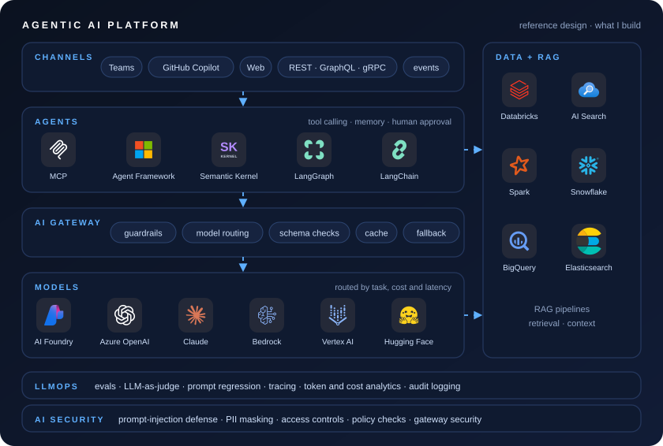

### 🧰 Stack at a glance

<table align="center">
<tr><td width="33%" valign="top"><b>🧠 Models and providers</b> 
one gateway, many models  
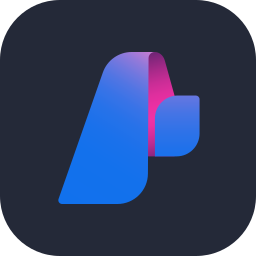
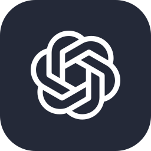

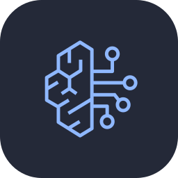
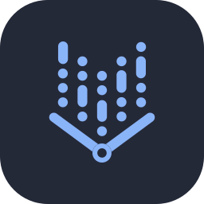

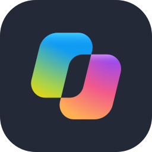
</td>
<td width="33%" valign="top"><b>🤖 Agents and orchestration</b> 
multi-agent · MCP · harness  

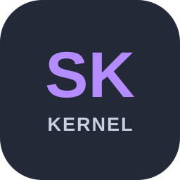
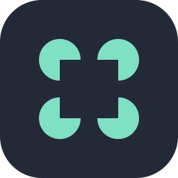
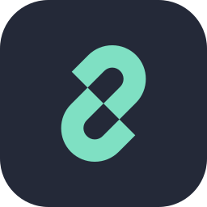
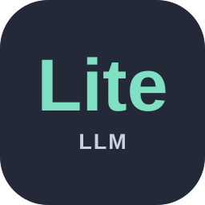
</td>
<td width="33%" valign="top"><b>🛡️ AI security</b> 
guardrails · injection defense · governance  
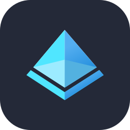

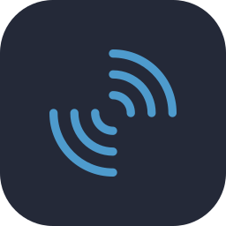

</td></tr>
<tr><td width="33%" valign="top"><b>🧱 Data-driven architecture</b> 
lakehouse · search · RAG  
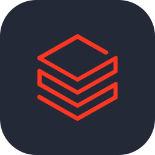

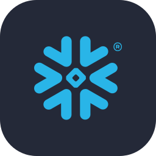
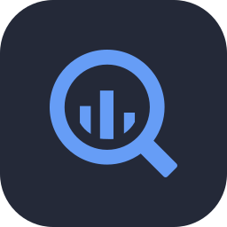
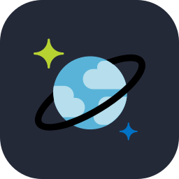

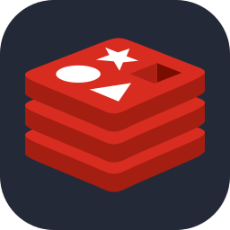
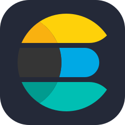
</td>
<td width="33%" valign="top"><b>⚡ Event-driven architecture</b> 
events · queues · gRPC · serverless  
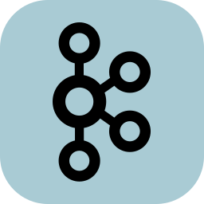
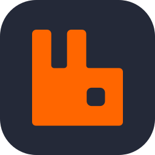
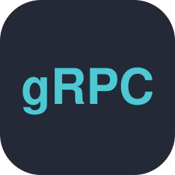
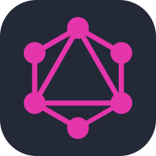
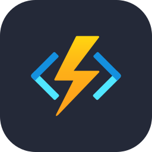
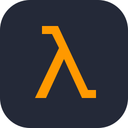
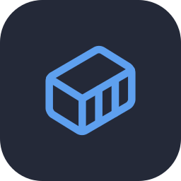
</td>
<td width="33%" valign="top"><b>📈 LLMOps and evaluation</b> 
evals · tracing · cost  
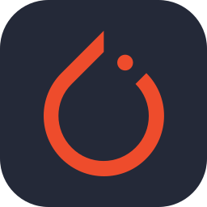
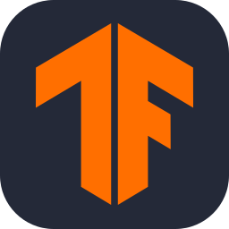
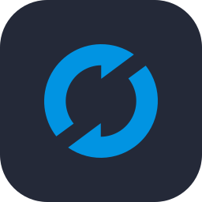

</td></tr>
</table>

### 🔎 Deep dives

<b>🤖 Agent orchestration and harness</b>

 

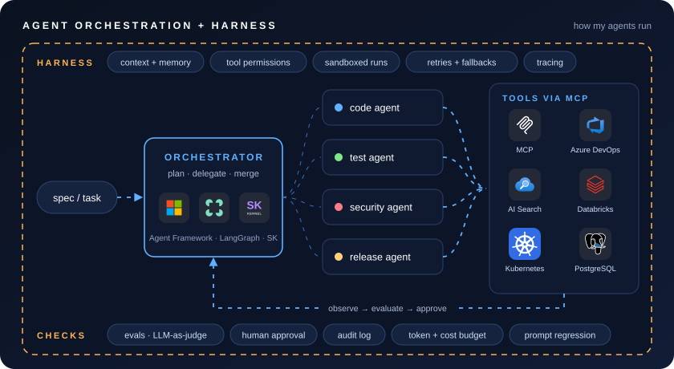

<b>🛡️ AI security: defense in depth</b>

 

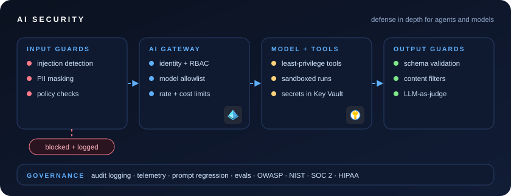

<b>⚡ Event-driven architecture and serverless</b>

 

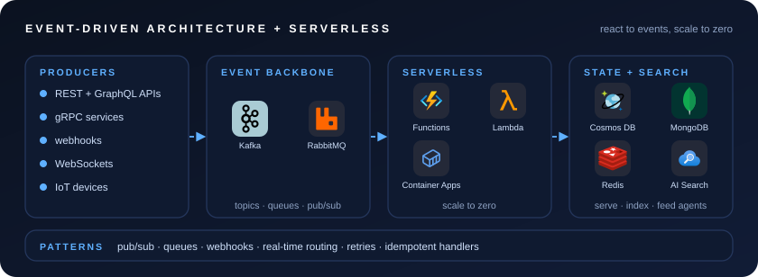

<b>🔀 Model routing</b>

 

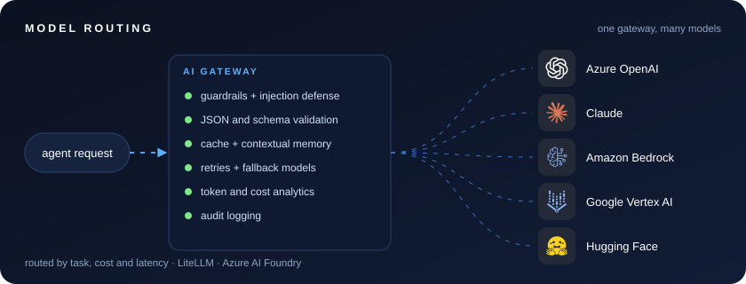

<b>🧱 Data-driven architecture: from data to AI</b>

 

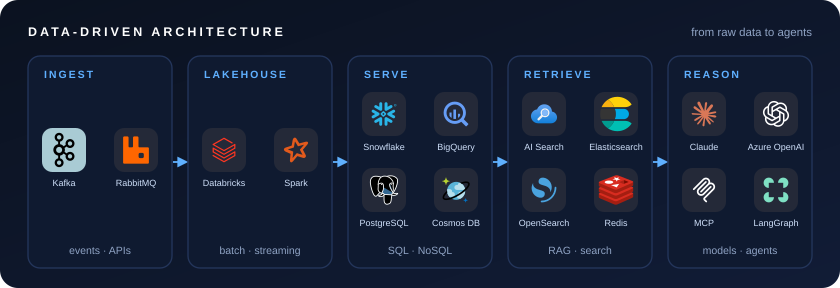

<b>🧰 Full toolbox · databases, languages, backend, frontend, cloud, quality, observability, collaboration</b>

 
<table align="center">
<tr><td align="right" width="190"><b>Databases and search</b></td><td>

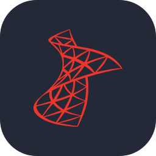
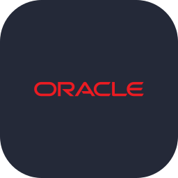

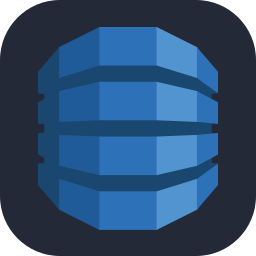

</td></tr>
<tr><td align="right" width="190"><b>Languages</b></td><td>

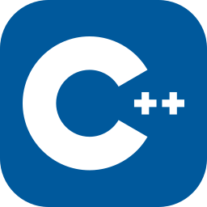
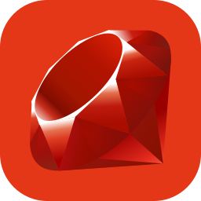

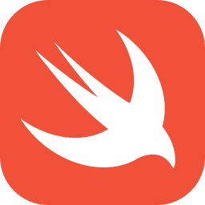
</td></tr>
<tr><td align="right" width="190"><b>Backend and APIs</b></td><td>

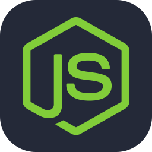

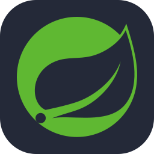

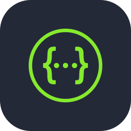
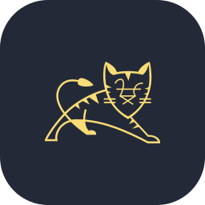
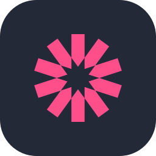
</td></tr>
<tr><td align="right" width="190"><b>Frontend and design</b></td><td>

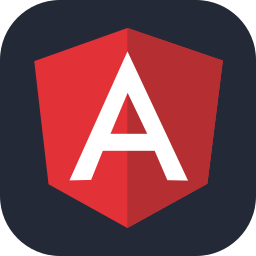

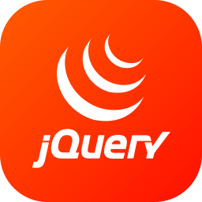
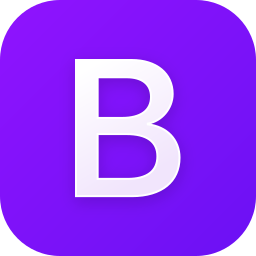
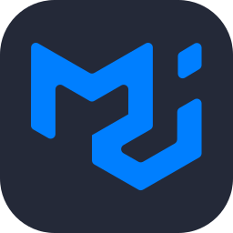
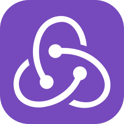

</td></tr>
<tr><td align="right" width="190"><b>Cloud and DevOps</b></td><td>

</td></tr>
<tr><td align="right" width="190"><b>Quality and testing</b></td><td>

</td></tr>
<tr><td align="right" width="190"><b>Observability</b></td><td>

</td></tr>
<tr><td align="right" width="190"><b>Collaboration and enterprise</b></td><td>

</td></tr>
</table>

<b>🌍 Industries · software, eCommerce, healthcare, insurance, banking, government, IoT</b>

 

<b>💼 Strategic advisory · agentic AI, AI security, data for AI, AI-driven SDLC</b>

 

<b>🎓 Credentials · Databricks, Microsoft, AWS, Anthropic, OpenAI, Google, Palantir</b>

 

